# School LMS & Student Monitoring Platform: Architecture Blueprint

> **Note:** This repository intentionally contains **no source code**. The system is a production-grade product built for real schools, so the code stays private. This document is the public blueprint: it shows how the system is designed, how data flows, and how security is handled.

**Author:** Bharat Kumar
**Stack:** FastAPI · PostgreSQL · Redis · Celery · React (Vite, PWA) · S3-compatible storage · Local SLM (Ollama)
**Status:** Active build. Foundation and identity layers are implemented; academic modules are in progress (see [Build Status](#12-build-status)).

---

## 1. What problem this solves

Schools and tuition institutes usually run attendance, marks, feedback and complaints on separate tools, or on paper. Teachers can't see a student's full picture, management can't see teacher quality, and parents hear about problems too late.

This platform gives one system with **three role-based portals**:

| Portal | Who uses it | What they do |
|---|---|---|
| **Admin** | Director, Principal, Headmaster, LMS Operator | Approve registrations, monitor everything, handle tickets, publish results |
| **Teacher** | Subject teachers, class teachers | Upload marks, see class-wise student monitoring, ask the AI assistant about any student's performance, view feedback and complaints (anonymised) |
| **Student / Parent** | Students (class 9+) and parents (all classes) | View own dashboard, give per-chapter teacher feedback, raise tickets |

**Key design rule:** students never see other students' data, and teachers never see who complained about them.

---

## 2. System architecture

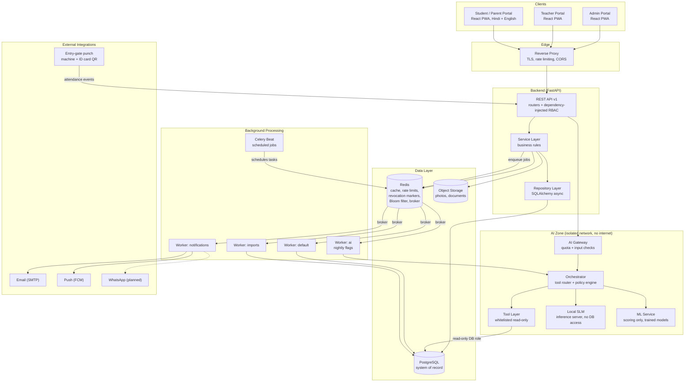

**Why this shape**

- **Layered backend** (router, service, repository): business rules live in one place, so a rule like "only the subject teacher can edit marks" can't be bypassed by a new endpoint.
- **Redis + Celery from day one**: emails, notifications and bulk imports never block a request. Sized for roughly 250 to 2000 students per institution. Celery Beat only schedules: it drops tasks onto the Redis queue and the workers pick them up from there.
- **PostgreSQL as the only source of truth**: Redis is used for speed and safety (rate limits, revocation), never as the only copy of important data.
- **On-premise, isolated AI**: the language model runs on the school's own server inside a separate network zone with no internet access and no database credentials. No student data is ever sent to an outside AI service (see [section 9](#9-ai-student-performance-assistant)).

---

## 3. Role and access model

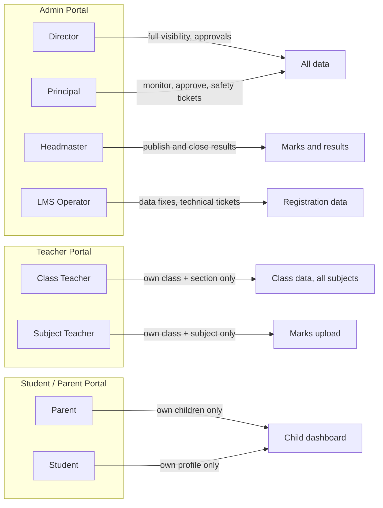

**Access rules enforced in the backend (not just the UI)**

- Role is checked on **every request** by reloading the account from the database, so a suspended user or a changed role takes effect immediately instead of waiting for token expiry.
- Ownership checks return "not found" instead of "forbidden", so attackers can't discover which records exist.
- A class teacher sees all subjects, but only for their own class and section.
- One email or phone number can hold multiple profiles (for example a parent with several children, or a teacher who is also a parent), with a profile switcher. Switching into an admin-level profile requires re-entering the password.

---

## 4. Authentication and session flow

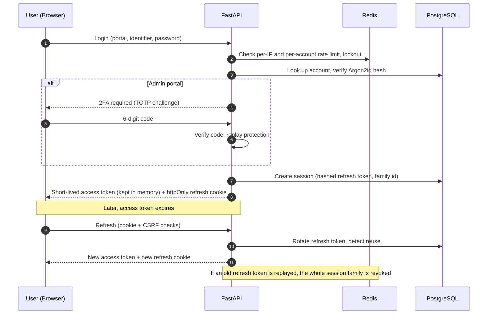

**Security controls in this flow**

| Control | Purpose |
|---|---|
| Argon2id password hashing, constant-time verify for unknown users | Resistant to cracking and to account-enumeration timing attacks |
| Short-lived access token held in memory only | Nothing sensitive in localStorage |
| Rotating refresh tokens in httpOnly, per-portal cookies | Stolen cookies are detected and the whole token family is revoked |
| CSRF defence: SameSite + Origin check + custom header | Protects cookie-based refresh |
| Account lockout and per-IP rate limiting (fail-closed if Redis is down) | Brute-force protection |
| TOTP 2FA with recovery codes for management accounts | Protects the most powerful accounts |
| Per-portal session lifetimes (shorter for admin) | Higher privilege means shorter sessions |
| Bloom filter for username availability | Fast, privacy-friendly username checks at scale |

---

## 5. Registration and approval workflow

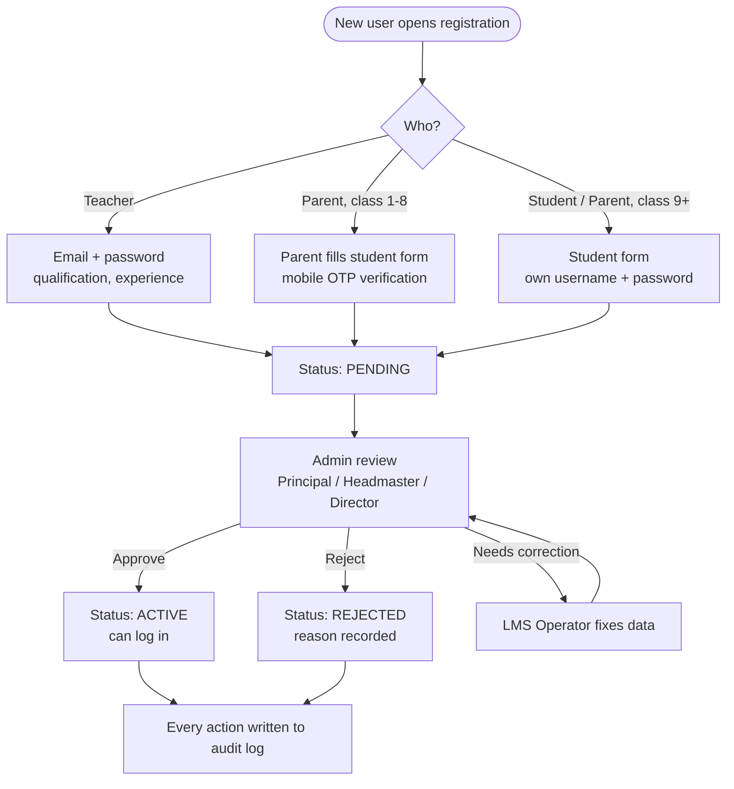

Notes: parents of younger students (class 8 and below) usually hold the only phone in the family, so the parent profile owns the monitoring view. From class 9, the family chooses whose phone is used. Student data collection includes recorded consent for data-protection compliance. Students re-register each academic year.

---

## 6. Attendance workflow

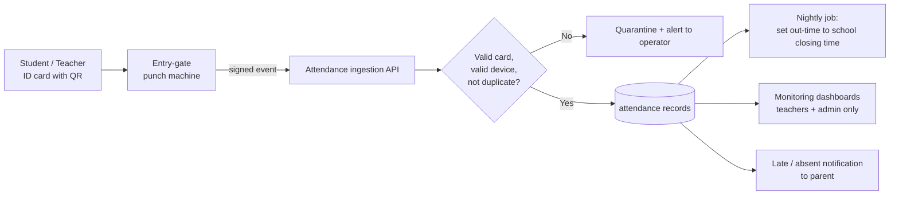

Design decision: attendance comes **only** from the punch machine. There is no manual marking, which removes proxy attendance and teacher workload. Corrections go through the operator and are audit-logged.

---

## 7. Marks and results workflow

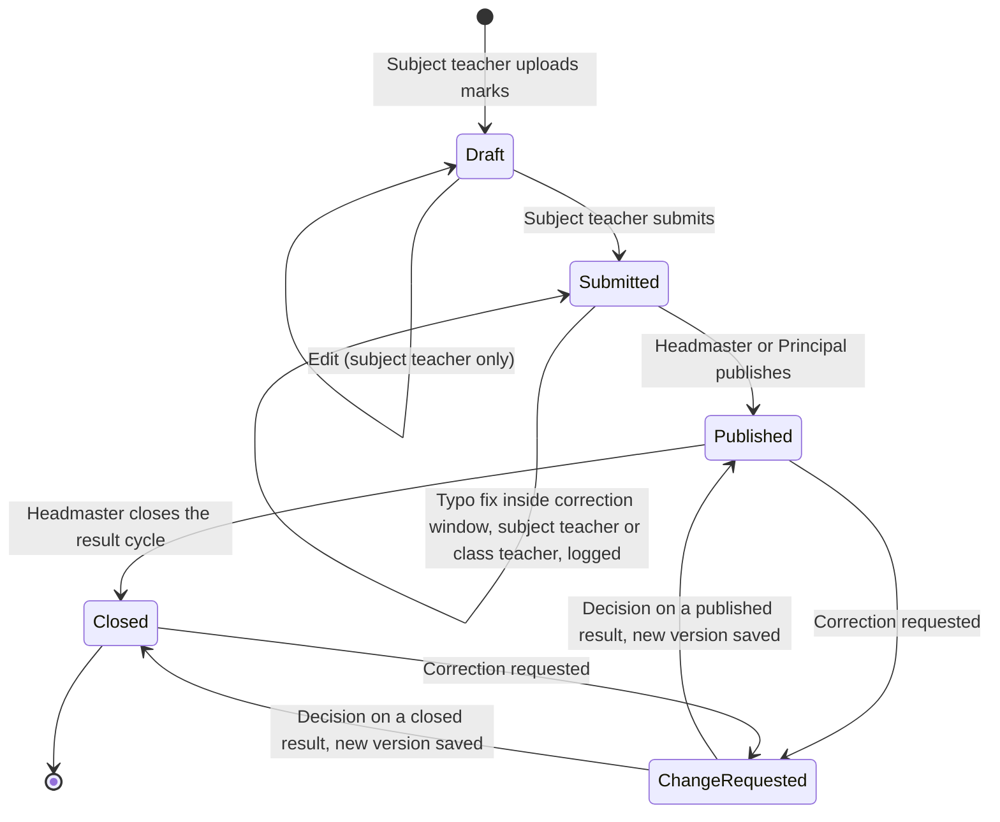

**Rules**

- Only the **subject teacher of that class and subject** can upload and edit marks while they are a draft.
- After the teacher submits, a short **correction window** opens (length set per institution). Inside it, the subject teacher **or the class teacher** can fix upload mistakes such as typos or swapped columns. Every fix is logged with old and new values.
- Once the window closes, or after publication, any change needs a **change request**. The Director or Principal approves or rejects it. An approved change creates a new version of the mark and the old version stays in the history.
- **Published** means students and parents can see the result. **Closed** means the result cycle is over; the Headmaster closes it by hand. Closed is the final state, and any later correction goes through a change request.
- Students never see monitoring analytics; they see only their published results.

---

## 8. Feedback and ticket workflow

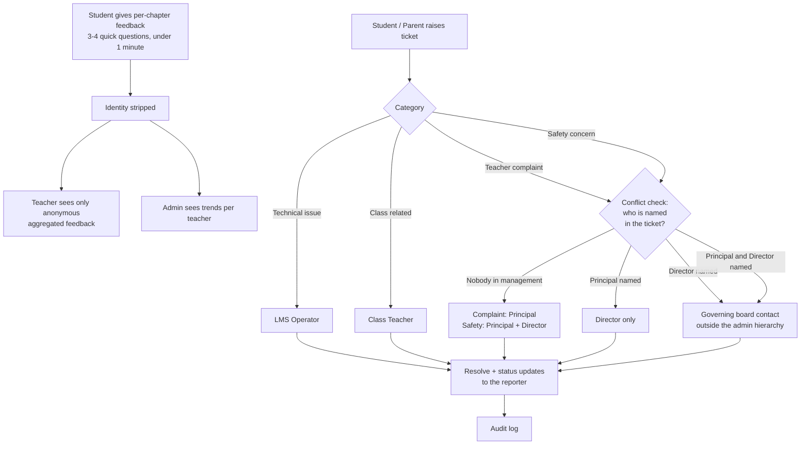

**Routing and privacy rules**

- **Conflict check on every complaint and safety ticket:** anyone named in the ticket is removed from its recipients and can never open it. The ticket moves to the next level up: a complaint about the Principal goes to the Director only, and a ticket naming the Director (or both) goes to a governing board contact configured per institution, outside the normal admin hierarchy.
- The LMS Operator and Headmaster cannot read the content of complaint or safety tickets; they see only technical status.
- Ticket identity is stored for accountability, but a teacher who is complained about only ever sees an anonymous ID.
- Feedback is shown to a teacher only after a minimum number of responses exist, so a single student cannot be identified.
- Tickets can be raised by a student **or a parent**; the raiser is recorded as a profile (see section 11).

---

## 9. AI student performance assistant

**Goal:** a teacher enters a student's **name, roll number, class and section**, then asks questions in plain language, for example *"Show Rahul's marks in all subjects"* (any teacher, for the subjects they teach) or *"Has his attendance dropped this term?"* (class teachers and management). Nobody has to track students by hand. A small local language model (SLM) understands the question and explains the result; the **database does all the calculation**, and the **existing security model decides what is allowed**.

**Core idea:** the AI is not a new system bolted on the side. It is one more client of the same backend rules. It has no powers of its own: whatever the logged-in teacher may see, it may fetch, and nothing more.

### 9.1 Where it sits in the system

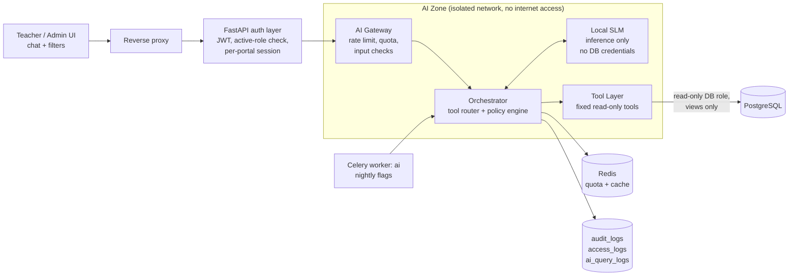

**How it reuses what already exists**

| Existing component | What the AI feature reuses it for |
|---|---|
| JWT sessions and per-request role reload (section 4) | The AI never trusts a token alone; a suspended teacher loses AI access immediately |
| Teaching assignments (section 11) | Defines each teacher's scope: which class, section and subject they may query |
| Marks workflow (section 7) | AI reads only **published or closed** marks, so a draft is never exposed |
| Access logs and audit logs | Every student profile opened through chat is logged exactly like a manual view |
| Redis | Per-user rate limits, daily quota, short result cache |
| Celery | Nightly flag generation, so the model is not needed for every screen load |

### 9.2 Life of one question

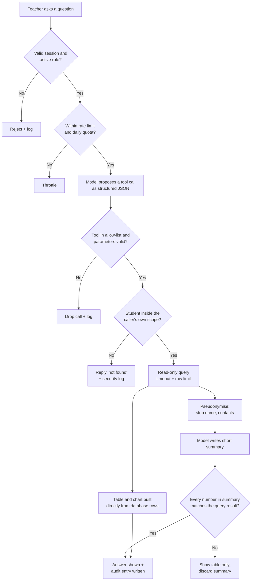

The same flow as a message sequence:

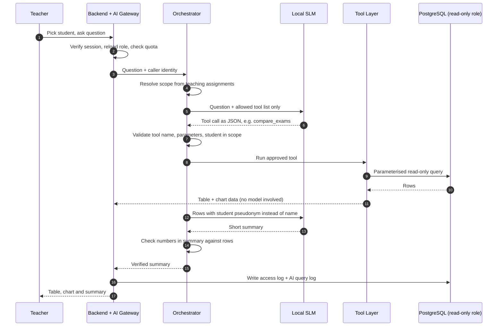

### 9.3 What the assistant can do (fixed tool catalogue)

The model cannot do anything outside this list. It cannot write SQL, call the internet, or change any data.

| Tool | Returns | Who can use it | Scope enforced |
|---|---|---|---|
| `find_student` | Matching students for name, roll no, class, section | Teacher, Management | Own classes only (management: all) |
| `get_marks` | Marks for one student, chosen subjects and exam types | Teacher, Management | Subject teacher: own subject. Class teacher: all subjects of own class |
| `compare_exams` | Class Test, Half-Yearly, Viva, Yearly side by side | Teacher, Management | Same as above |
| `get_trend` | Term-over-term change per subject | Teacher, Management | Same as above |
| `compare_with_class` | Student vs class average and rank band | Class Teacher, Management | Own class only |
| `get_attendance_summary` | Present, late, absent counts and pattern | Class Teacher, Management | Own class only |
| `list_flags` | Advisory flags for a student or class | Class Teacher, Management | Own class only |

**Who can ask what**

| Role | Marks, exam comparison, trends | Student vs class average | Attendance and flags |
|---|---|---|---|
| Subject teacher | Own subject, own classes | No | No |
| Class teacher | All subjects of own class and section | Yes, own class | Yes, own class |
| Management (Director, Principal, Headmaster) | All classes | Yes | Yes |
| LMS Operator | No (technical role, no student analytics) | No | No |

Students and parents do **not** get this assistant. They see only their own published results.

### 9.4 One-screen marks comparison

All exam types for all subjects appear together, so a teacher does not open separate pages. The teacher can pick any combination of subjects and exam types. *(Illustrative sample, not real student data.)*

| Subject | Class Test | Half-Yearly | Viva | Yearly | Trend |
|---|---|---|---|---|---|
| Mathematics | 18 / 25 | 62 / 100 | 9 / 10 | 71 / 100 | Improving |
| Science | 20 / 25 | 70 / 100 | 8 / 10 | 66 / 100 | Slight dip |
| English | 15 / 25 | 58 / 100 | 7 / 10 | 60 / 100 | Stable |
| Hindi | 21 / 25 | 78 / 100 | 9 / 10 | 80 / 100 | Improving |

Views: one student across subjects (a subject teacher sees only their own subject, a class teacher sees all subjects of their class), one subject across exam types, term-over-term trend charts, and student vs class average (class teacher and management only). This screen works **without the AI** (a plain filter form uses the same tools), so the chat is a convenience and never a single point of failure.

### 9.5 Automatic behaviour and performance signals

"Behaviour tracking" here means **spotting patterns in data the system already holds**, so no one has to watch every student manually.

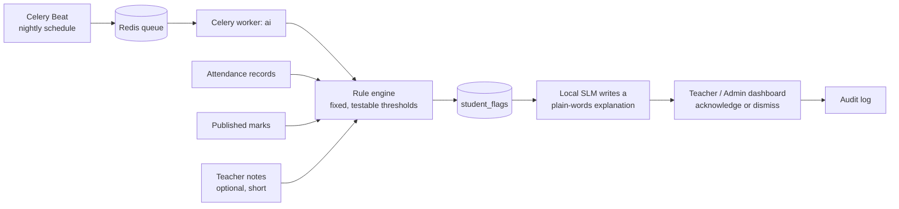

- The **rule engine decides what is unusual** (for example attendance below a set level, or marks falling in two exams in a row). These rules are ordinary code, so they can be unit-tested.
- The **model only phrases the explanation**. It cannot create or remove a flag.
- Flags are computed overnight and stored, so the dashboard opens instantly and works even if the model is down.
- A flag is a prompt for a human conversation, never a verdict. Teachers can acknowledge or dismiss it, and every action is logged.

### 9.6 Security design (defence in depth)

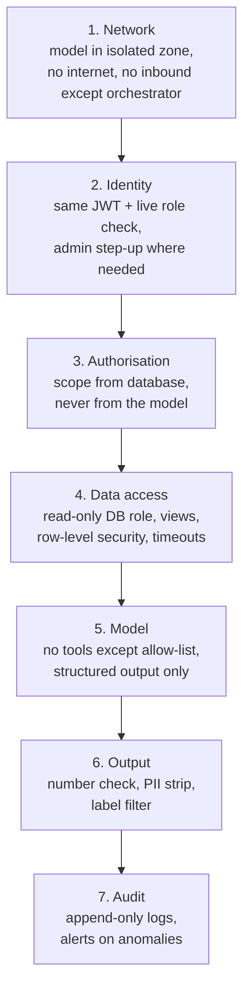

| Layer | Controls |
|---|---|
| **Network isolation** | The inference server sits in its own container network with no internet egress. Only the orchestrator can reach it. The model server holds **no database credentials**. |
| **Identity** | Reuses the platform login and per-request role reload. Suspending a user cuts AI access at once. |
| **Authorisation** | The orchestrator computes the caller's scope from teaching assignments in the database. The model's output is treated as a *suggestion*; scope is re-checked before every tool runs. Out-of-scope students return "not found", never "forbidden". |
| **Database** | A dedicated **read-only role** that can query only purpose-built **views** (no raw tables, no contact details, no authentication data). Row-level security backs up the application checks. Statement timeout and row limit on every query. |
| **Data minimisation** | The model sees a **pseudonym** (for example `S-7F3A`), subject names and scores. Names, phone numbers, addresses and parent details are never sent to it. The real name is re-attached only in the UI after the answer is built. |
| **Prompt injection** | Teacher notes and student fields are passed as quoted data, never as instructions. Tool results are treated as untrusted. The model may only answer in a fixed JSON schema; anything else is discarded. |
| **No-hallucination rule** | Figures on screen come from SQL, not the model. Before a summary is shown, every number in it is checked against the query result. A mismatch means the summary is dropped and only the table is shown. |
| **Output filter** | Removes personal data, blocks labels such as "weak" or "problem student", and keeps wording factual and advisory. |
| **Abuse and cost control** | Per-user rate limit and daily quota in Redis, maximum rows per answer, maximum question length. If Redis is unavailable, the assistant **fails closed**. |
| **Logging** | Every question is recorded with caller, student, tool and parameters, and row count in `ai_query_logs`. Profile views also go to `access_logs`. Logs are append-only and readable only by Principal and Director. |
| **Model supply chain** | Model files are downloaded once, verified against a checksum, version-pinned and stored offline. Updates are a reviewed deployment step, not automatic. |
| **Kill switch** | Management can switch the assistant off per institution at any time. The rest of the platform continues unaffected. |
| **Retention** | Question text is kept for a limited period, then reduced to metadata (who, when, which tool). |

### 9.7 Threat model

| Threat | How it is stopped |
|---|---|
| A teacher tries to read another class through the chat ("show me 9-B") | The scope is resolved from the database, not from the question. Out-of-scope requests return "not found" and raise a security log entry. |
| Malicious text hidden in a note tries to take over the model | Notes are quoted data. Output must match a fixed schema and the tool allow-list, so injected instructions have nothing to act on. |
| Model invents a mark or a trend | Numbers come from the database, and the summary is verified against the result before display. |
| Data leaks to an outside service | The model has no internet access, and no external AI API exists anywhere in the design. |
| Model tricked into writing or deleting data | It has no write tools, and its database role is read-only. |
| Heavy or repeated queries slow the system down | Quotas, row limits, query timeouts and a circuit breaker. Marks entry and login are unaffected because the AI zone is separate. |
| Wrong student selected because of similar names | Ambiguous matches force the teacher to confirm using roll number, class and section. |
| Stolen teacher account used to browse students | Same login protections as the rest of the platform, plus anomaly alerts on unusual query volume. Everything is traceable in the logs. |
| Tampered model file | Checksum verification on load and offline, version-pinned storage. |
| Logs themselves leak student data | Logs hold identifiers and metadata, restricted to senior management, and question text expires. |

### 9.8 Failure behaviour

| If this fails | What happens |
|---|---|
| Local model is down | Filters, tables, charts and stored flags still work. Only chat and plain-words summaries pause. |
| Redis is down | The assistant stops (fail closed). The rest of the platform follows its own existing rules. |
| Query takes too long | It is cancelled, and the teacher gets a "try a narrower question" message. |
| Summary fails verification | Only the verified table is shown. |

### 9.9 How it will be tested

- **Authorisation tests:** automated negative tests for every tool (wrong class, wrong subject, suspended user, draft marks).
- **Prompt-injection tests:** a fixed set of hostile notes and questions must never change tool choice or scope.
- **Number-consistency tests:** generated summaries are compared with database results on a golden question set.
- **Rule-engine unit tests:** each flag rule is tested with borderline data.
- **Load and penetration test:** included in Phase 8 together with the rest of the platform.

### 9.10 Delivery order (safest first)

1. **Phase 3 and 4:** exam types, marks and the **deterministic** multi-exam comparison screen, with no AI involved.
2. **Phase 4:** rule engine and stored flags, still without the model.
3. **Phase 7:** local SLM, orchestrator, policy engine, tool layer and chat UI on top of the already-tested tools.
4. **Phase 8:** red-team and penetration test of the AI zone before release.

Building the data and rules first means the AI is only a thin, replaceable layer over parts that are already verified.

---

## 10. AI/ML capability map

This platform is designed AI/ML-first: wherever a task is repetitive, pattern-based or text-heavy, a model should do the groundwork and a human should make the decision. Section 9 covers the teacher-facing assistant. This section lists **every other place** where AI/ML fits, and the rules that keep it safe.

### 10.1 Design principles for AI/ML here

1. **Rules first, ML when data exists.** A school has hundreds, not millions, of students. Models stay switched off until enough history exists; fixed rules cover the gap.
2. **Simple, explainable models.** Logistic regression, gradient boosting, regression and clustering beat deep learning on small data and can show the reasons behind every score.
3. **AI advises, people decide.** Nothing a model produces changes a mark, a ticket status or a student record without a human action.
4. **Everything runs locally.** Training and scoring happen on the school's own server. No student data leaves it.
5. **Language models write, they do not calculate.** Numbers always come from the database or a scored model, never from free text generation.

### 10.2 Use-case map

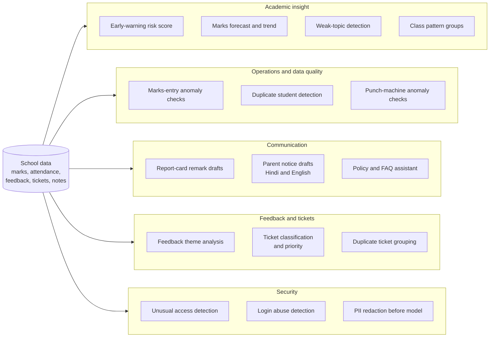

### 10.3 Use cases by readiness

**Tier 1: works from day one (little or no history needed)**

| Use case | What it does | Technique | Human step |
|---|---|---|---|
| Report-card remarks | Drafts a short remark per student from verified marks, attendance and trend | Local SLM with templates | Teacher edits and approves |
| Parent notices and translation | Drafts circulars, reminders and progress summaries in simple Hindi or English | Local SLM or translation model | Admin approves before sending |
| Policy and FAQ assistant | Answers parents' questions on fees, timetable and rules from school documents | RAG over public school documents only, no student data | Hands over to the office when unsure |
| Ticket classification and priority | Suggests category and urgency, spots safety wording | Small text classifier or SLM | AI may only **raise** priority, never lower it; a human confirms routing |
| Marks-entry anomaly checks | Catches marks above the maximum, swapped columns, sudden class-wide jumps | Statistical rules and outlier detection | Teacher confirms before submitting |
| Duplicate student detection | Spots the same child registered twice, or sibling mismatches | Fuzzy matching on name, date of birth, parent contact | Operator decides |
| Unusual access detection | Flags a user opening far more student profiles than normal, or at odd hours | Per-user baseline and anomaly detection on access logs | Alert goes to Principal and Director |
| PII redaction | Removes names and phone numbers from free text before any model sees it | Pattern rules plus a small entity-recognition model | Automatic, logged |

**Tier 2: after one full term of real data**

| Use case | What it does | Technique | Human step |
|---|---|---|---|
| Early-warning risk score | Estimates which students may need support before the next exam | Logistic regression or gradient boosting | Teacher sees the top reasons and acknowledges or dismisses |
| Marks forecast | Gives an expected range for the next exam | Simple regression or time-series smoothing | Shown as a range, never as a grade |
| Attendance patterns | Finds repeated weekday absences, late-arrival trends and faulty punch devices | Time-series analysis and clustering | Class teacher or operator |
| Feedback theme analysis | Summarises topics and sentiment in feedback per teacher, anonymised | Topic modelling and SLM summaries, minimum response count | Management sees trends; teachers see aggregates only |
| Duplicate ticket grouping | Links repeated complaints about the same issue | Text embeddings and similarity | Principal or operator |

**Tier 3: needs richer data**

| Use case | What it does | Technique | Human step |
|---|---|---|---|
| Weak-topic detection | Shows which chapters a student or class struggles with | Item analysis; needs chapter-wise or question-wise marks | Teacher plans remedial work |
| Class pattern groups | Groups students as steady, improving or fluctuating, for class planning | Clustering | Planning view only; no labels shown on a child |
| Teacher-support insights | Compares class progress with expected progress instead of raw marks | Regression on prior performance | Management only, used for support and never for ranking |
| Revision suggestions | Suggests chapters to revise before exams | Rules over weak topics, SLM wording | Teacher approves before sharing |
| Timetable optimisation | Builds a clash-free timetable | Constraint solver (not ML) | Admin reviews |

### 10.4 Model lifecycle

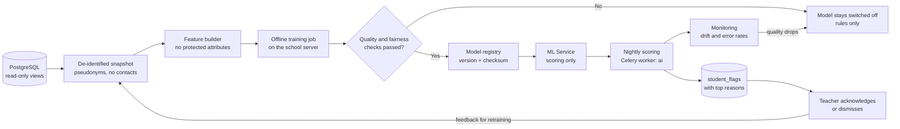

### 10.5 Responsible-AI rules

| Rule | Why |
|---|---|
| No protected attributes (gender, religion, caste, family income, disability) as model inputs | Prevents unfair scoring |
| Fairness check across sections and groups before a model is enabled | A model that works worse for one group is not released |
| Every score shows its top reasons | Teachers can judge it instead of trusting it blindly |
| Minimum data before enabling (at least one full term, and a minimum number of students) | Avoids confident predictions from too little data |
| Thresholds set by management and logged | Sensitivity is a school decision |
| Advisory only, no labels like "weak" or "problem student" | Protects children from being labelled |
| Parent-facing text is always approved by a human | Prevents wrong or tone-deaf messages |
| Models are versioned, checksum-verified and monitored for drift | A silent quality drop switches the model off |
| Children's data handled under consent and purpose limits | Compliance with applicable data-protection law (to be confirmed with legal advice) |

### 10.6 Delivery order

1. **Phases 3 to 6:** exam data, rules, flags and the Tier 1 drafting and checking tools.
2. **Phase 7:** isolated model zone, assistant (section 9) and Tier 1 language features.
3. **After the first full term in production:** Tier 2 models, enabled only after the quality and fairness checks.
4. **Later:** Tier 3, once richer data (chapter-wise marks) is being collected.

---

## 11. Data model (high level)

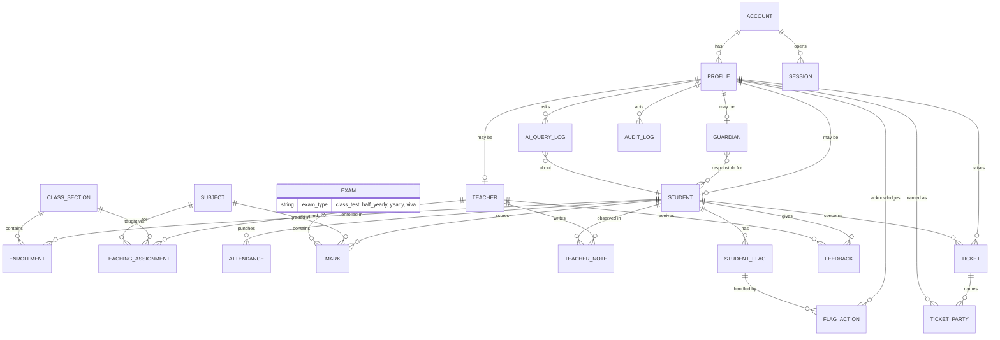

Every mark belongs to exactly one student, one exam and one subject. A ticket is raised by a profile (student or parent) and keeps a list of named parties for the conflict check in section 8.

Cross-cutting tables: `audit_logs` (append-only, enforced by database triggers so even application bugs can't rewrite history), `access_logs` (who viewed which student profile, partitioned by time) and `ai_query_logs` (which question was asked about which student, by whom, using which tool). The AI zone reads data only through dedicated read-only database **views**, never directly from the main tables.

**Tenancy decision:** each school gets its **own database and its own deployment**. There is no shared multi-tenant database, which removes the whole class of cross-school data leaks and lets each institution have a custom UI and configuration.

---

## 12. Build status

| Phase | Scope | Status |
|---|---|---|
| 0 | Foundation: project skeleton, DB migrations, Redis + Celery, theming, i18n (Hindi/English), PWA shell | Complete |
| 1 | Identity and access: accounts, login per portal, JWT sessions, RBAC, admin 2FA, registration, audit and access logs, email service | In progress (core auth complete) |
| 2 | Academic structure: classes, sections, subjects, teacher assignments, enrollments, setup wizard, ID card QR | Planned |
| 3 | Attendance, exams (class test, half-yearly, yearly, viva), marks, result publishing, grading schemes | Planned |
| 4 | Student monitoring dashboards, one-screen multi-exam marks comparison, rule engine and stored student flags (no AI needed) | Planned |
| 5 | Feedback and tickets | Planned |
| 6 | Reports and notifications (email, push, WhatsApp), AI-drafted report remarks and notices (teacher approved) | Planned |
| 7 | AI/ML layer (sections 9 and 10): isolated local SLM, assistant, policy engine, read-only DB views, ML models for early warning, forecasting and anomalies | Planned |
| 8 | Security hardening, load and penetration testing, including AI red-team tests | Planned |
| 9 | Integration, release candidate, deployment | Planned |

The platform has about 140 tracked tasks in total, delivered phase by phase.

---

## 13. Engineering process

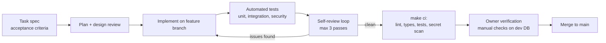

- Work is split into small tasks, each with acceptance criteria, one branch and one merge gate.
- Architecture decisions are recorded as numbered ADRs (single-institution tenancy, token strategy, password hashing, step-up auth and more).
- Quality gates: linting, strict type checks, around 95% backend coverage, secret scanning in pre-commit, and a test-database safety guard so tests can never touch development data.
- Security-sensitive areas (auth, marks, tickets, notifications) always get a manual owner review before merge.

---

## 14. Design principles

1. **Security by default:** deny by default, re-check on every request, log everything sensitive.
2. **Simple for users, strict in the backend:** the UI is minimal; the rules are enforced server-side.
3. **Low running cost:** free push notifications, WhatsApp only for important messages, self-hostable stack.
4. **Automation first:** gate punch, scheduled jobs and AI-assisted insights replace manual work.
5. **Per-institution isolation:** separate database and deployment per school.
6. **AI explains, the database calculates:** the language model understands questions and writes summaries; every number comes from a validated query, and every AI action is logged.
7. **The AI has no privileges of its own:** it inherits the logged-in user's scope, runs in an isolated zone, and can only call a fixed list of read-only tools.
8. **Deterministic first, AI on top:** tables, rules and flags work without the model, so the AI is a replaceable layer rather than a dependency.
9. **Rules first, ML when data exists:** models are enabled only after enough history and passing quality and fairness checks, and they only advise.

---

*Source code is private. Architecture walkthroughs and a live demo are available on request.*
